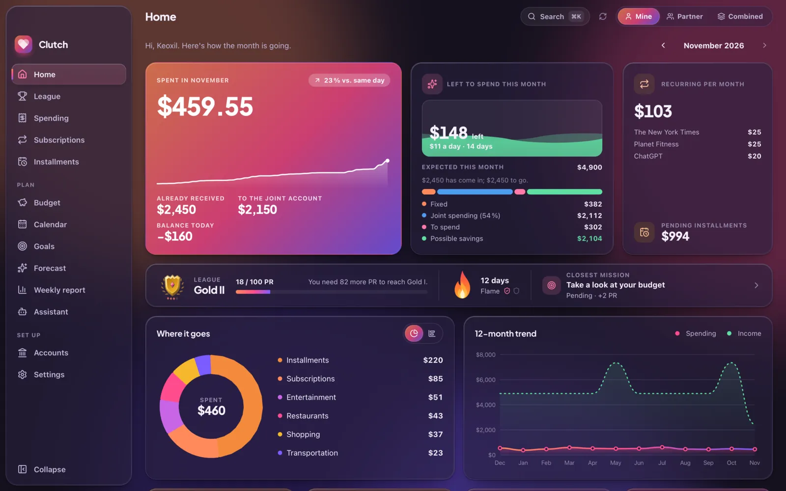
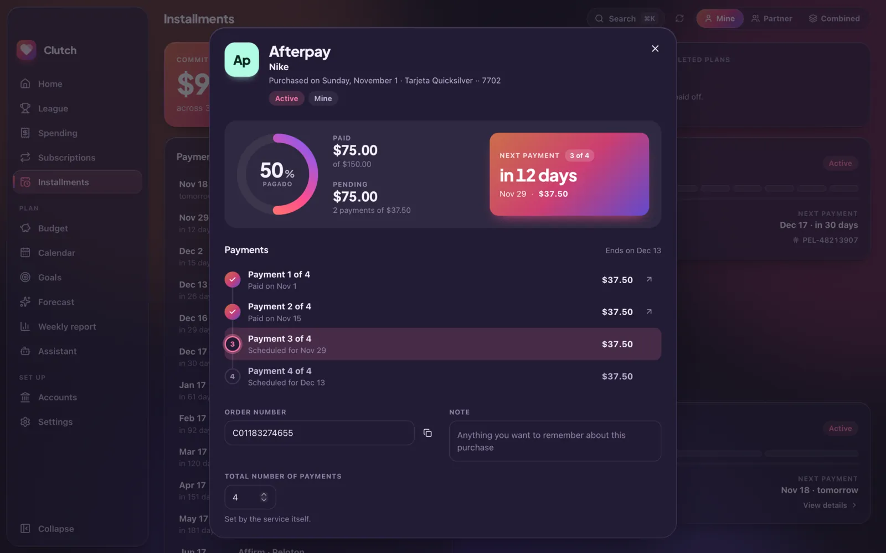
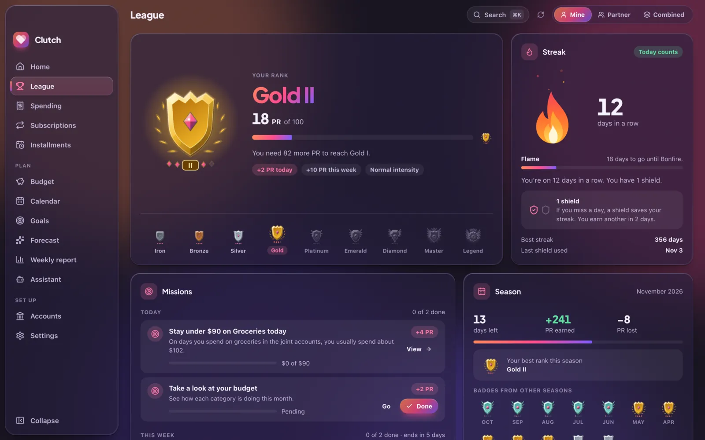
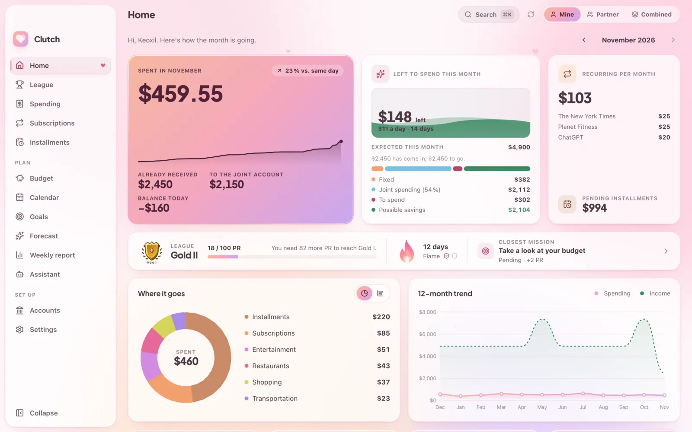

<h1 align="center">Clutch</h1>

<b>All your money, without writing anything down.</b> A beautiful, animated personal finance app for couples — macOS, Windows and web.

  <a href="https://github.com/Keoxil/clutch-releases/releases/latest"><b>⬇️ Download the latest release</b></a>

This repository only hosts the installers. The source code is private.

### Features
- Bank sync every 6 h, automatic categories, subscription and recurring-payment detection
- Buy-now-pay-later plans (Afterpay, Klarna, Affirm, Zip...) with installment timelines
- Personal spending forecast with a "what if" simulator
- Budgets, goals, weekly report and a calendar of upcoming charges
- A savings League with ranks, streak flames and couple duels
- Mine / Partner / Combined views, 5 themes, English and Spanish
- Liquid Glass on macOS, Fluent and Mica on Windows

 

### Install
- **macOS (Apple Silicon):** download the `.dmg`, open it and drag Clutch to Applications. It isn't signed yet: the first time, if macOS says Apple cannot check it, go to System Settings → Privacy & Security → **Open Anyway** (or right-click the app → **Open**).
- **Windows:** download `…x64-setup.exe`. If Windows warns about an unknown publisher: **More info → Run anyway**.
- **iPhone:** use the web app in Safari → **Share → Add to Home Screen**.

> ⚠️ Early test builds (0.0.x): expect bugs.
